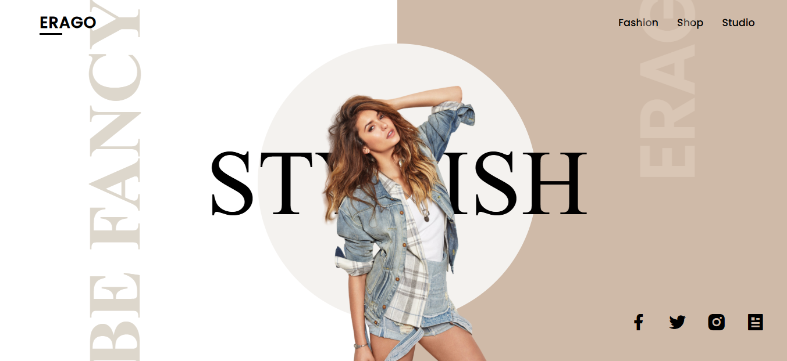
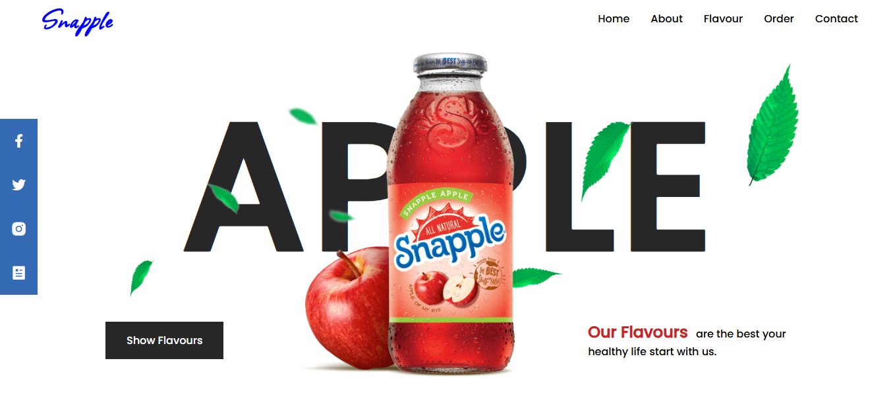
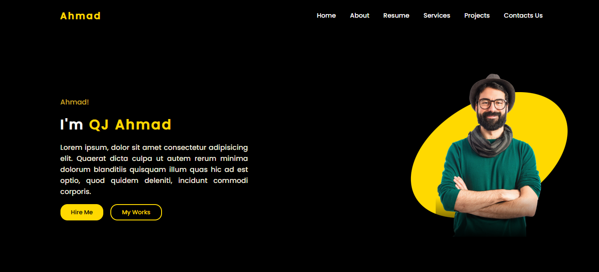
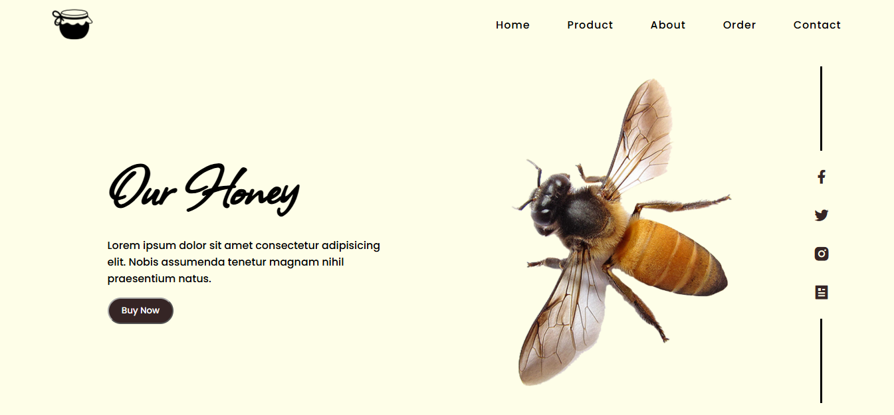
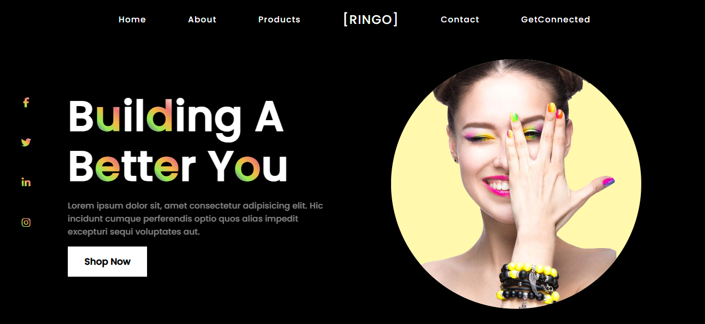
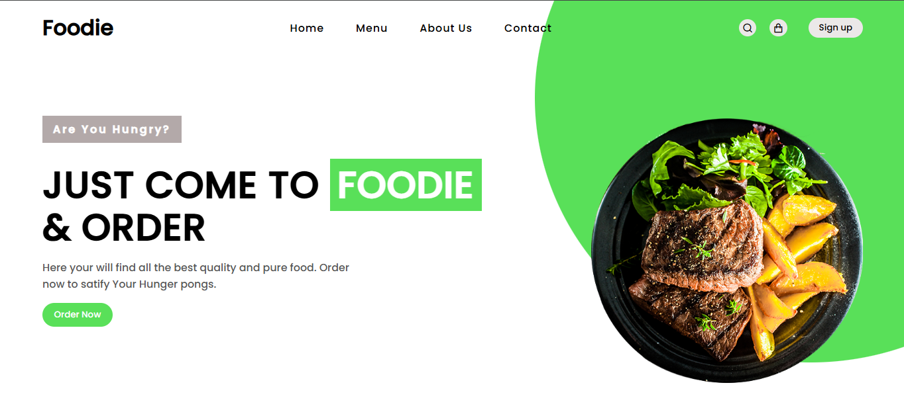

# 🌐 HTML & CSS Projects

A collection of frontend projects built using HTML, CSS, and JavaScript while learning and practicing web development.

This repository showcases my journey in frontend development through different landing pages, website layouts, and UI designs.

## 📂 Projects

| # | Project | Description | Technologies |
|---|---|---|---|
| 1 | [Nike Shoes](./NIKE%20SHOES/) | Nike Shoes landing page | HTML, CSS |
| 2 | [STYLISH](./STYLISH/) | Stylish landing page | HTML, CSS |
| 3 | [PET DOG](./PET%20DOG/) | Pet Dog landing page | HTML, CSS |
| 4 | [AI VOICE ASSISTANT](./AI%20VOICE%20ASSISTANT/) | AI Voice Assistant landing page | HTML, CSS, JavaScript |
| 5 | [Game Homeland](./GAME%20HOMELAND/) | Gaming landing page | HTML, CSS |
| 6 | [FURNITURE LANDPAGE](./FURNITURE%20LANDPAGE/) | Furniture landing page | HTML, CSS |
| 7 | [SNAPPLE LANDPAGE](./SNAPPLE/) | Snapple landing page | HTML, CSS |
| 8 | [PORTFOLIO LANDPAGE](./PORFOLIO/) | Personal portfolio landing page | HTML, CSS |
| 9 | [HONEYBEE LANDPAGE](./HONEYBEE/) | HoneyBee landing page | HTML, CSS |
| 10 | [BOSTON ROUND LANDPAGE](./BOSTON%20ROUND/) | Boston Round landing page | HTML, CSS |
| 11 | [BEEF STREAK LANDPAGE](./BEEF%20STREAK/) | Beef Streak landing page | HTML, CSS |
| 12 | [RINGO](./RINGO/) | Fashion landing page | HTML, CSS |
| 13 | [FOODIE](./FOODIE/) | Food ordering website with interactive UI | HTML, CSS, JavaScript |
| 14 | [CODING MASTER](./CODING%20MASTER/) | Coding Master landing page | HTML, CSS |

## 🖼️ Project Previews

<table>
  <tr>
    <td align="center" width="33%">
      <b><a href="./NIKE%20SHOES/">Nike Shoes</a></b>  
      
    </td>
    <td align="center" width="33%">
      <b><a href="./STYLISH/">STYLISH</a></b>  
      
    </td>
    <td align="center" width="33%">
      <b><a href="./PET%20DOG/">PET DOG</a></b>  
      
    </td>
  </tr>
  <tr>
    <td align="center" width="33%">
      <b><a href="./AI%20VOICE%20ASSISTANT/">AI VOICE ASSISTANT</a></b>  
      
    </td>
    <td align="center" width="33%">
      <b><a href="./GAME%20HOMELAND/">Game Homeland</a></b>  
      
    </td>
    <td align="center" width="33%">
      <b><a href="./FURNITURE%20LANDPAGE/">FURNITURE LANDPAGE</a></b>  
      
    </td>
  </tr>
  <tr>
    <td align="center" width="33%">
      <b><a href="./SNAPPLE/">SNAPPLE LANDPAGE</a></b>  
      
    </td>
    <td align="center" width="33%">
      <b><a href="./PORFOLIO/">PORTFOLIO LANDPAGE</a></b>  
      
    </td>
    <td align="center" width="33%">
      <b><a href="./HONEYBEE/">HONEYBEE LANDPAGE</a></b>  
      
    </td>
  </tr>
  <tr>
    <td align="center" width="33%">
      <b><a href="./BOSTON%20ROUND/">BOSTON ROUND</a></b>  
      
    </td>
    <td align="center" width="33%">
      <b><a href="./BEEF%20STREAK/">BEEF STREAK</a></b>  
      
    </td>
    <td align="center" width="33%">
      <b><a href="./RINGO/">RINGO</a></b>  
      
    </td>
  </tr>
  <tr>
    <td align="center" width="33%">
      <b><a href="./FOODIE/">FOODIE</a></b>  
      
    </td>
    <td align="center" width="33%">
      <b><a href="./CODING%20MASTER/">CODING MASTER</a></b>  
      
    </td>
  </tr>
</table>

## 🛠️ Technologies Used

- HTML5
- CSS3
- JavaScript
- Flexbox
- CSS Grid
- Responsive Web Design

## 🎯 What I Practiced

- Building website layouts using HTML and CSS
- Creating landing pages and UI designs
- Working with Flexbox and CSS Grid
- Styling and positioning elements
- Practicing responsive design
- Adding basic interactivity using JavaScript
- Building an interactive shopping cart system

## 📌 About This Repository

This repository contains my frontend practice projects. I continuously work on improving my HTML, CSS, JavaScript, and UI development skills.

More projects will be added as I continue learning and building.
